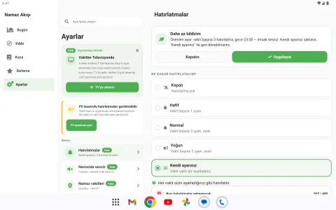
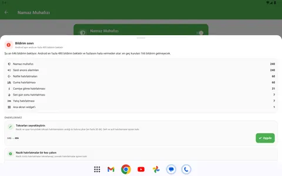

# Namaz Akışı — ekran görüntüleri

<!-- Bu sayfa scripts/belgeleri-guncelle.js ile üretilir; elle düzenlemeyin (kaynak: scripts/belge-gorsel-gruplari.js + manifest.json). -->

Güncel sürüm: **0.65.0** · Mağazada: Google Play: **0.45.0** · App Store: **0.41.1**. Mağaza kareleri Google Play ve App Store'daki güncel listelerden, diğerleri uygulamanın ekran görüntüsü hatlarından (yalnız ana dala girmiş sürümler) gelir.

## Mağazalarda

### Google Play

<table>
  <tr><td align="center"></td><td align="center"></td><td align="center"></td><td align="center"></td></tr>
  <tr><td align="center"></td><td align="center"></td><td align="center"></td><td align="center"></td></tr>
</table>

### App Store

<table>
  <tr><td align="center"> Ana ekran</td><td align="center"> Muhafız zaman şeridi</td><td align="center"> Adım detay</td><td align="center"> Seri</td></tr>
  <tr><td align="center"> Kıble</td><td align="center"> Akış önizleme</td><td align="center"> Kaza</td><td align="center"> İstatistik</td></tr>
</table>

### Google Play — Wear OS

<table>
  <tr><td align="center"></td><td align="center"></td><td align="center"></td><td align="center"></td></tr>
  <tr><td align="center"></td><td align="center"></td></tr>
</table>

### Google Play — Android TV

<table>
  <tr><td align="center"></td><td align="center"></td></tr>
  <tr><td align="center"></td></tr>
</table>

## Uygulamanın tüm ekranları

### Android — tüm ekranlar (açık tema)

<table>
  <tr><td align="center"> Ana ekran</td><td align="center"> Ana nafile zinciri</td><td align="center"> Sade görünüm</td><td align="center"> Ayarlar</td></tr>
  <tr><td align="center"> Ayarlar alt</td><td align="center"> Muhafız</td><td align="center"> Muhafız zaman şeridi</td><td align="center"> Adım detay</td></tr>
  <tr><td align="center"> Adım detay anahtarlar</td><td align="center"> Alarm onay</td><td align="center"> Muhafız bütçe kartı</td><td align="center"> Bildirim sınırı rehberi</td></tr>
  <tr><td align="center"> Bildirim ayarları</td><td align="center"> Cuma</td><td align="center"> Yatış</td><td align="center"> Camiye git</td></tr>
  <tr><td align="center"> Bileklik rehberi</td><td align="center"> Nafile</td><td align="center"> Nafile teheccüd</td><td align="center"> Now bar</td></tr>
  <tr><td align="center"> Now bar alt</td><td align="center"> Otomasyon rehberi</td><td align="center"> Otomasyon rehberi alt</td><td align="center"> Kıldım uygulamaları</td></tr>
  <tr><td align="center"> Camideyim ayarlar</td><td align="center"> Camideyim harita</td><td align="center"> Camideyim nasıl</td><td align="center"> Kaza</td></tr>
  <tr><td align="center"> Kaza her farzla</td><td align="center"> Neler yeni</td><td align="center"> Seferîlik</td><td align="center"> Kıble</td></tr>
  <tr><td align="center"> İlerleme</td></tr>
</table>

### Android — koyu tema

<table>
  <tr><td align="center"> Ana ekran</td><td align="center"> Ana nafile zinciri</td><td align="center"> Sade görünüm</td><td align="center"> Ayarlar</td></tr>
  <tr><td align="center"> Ayarlar alt</td><td align="center"> Muhafız</td><td align="center"> Muhafız zaman şeridi</td><td align="center"> Adım detay</td></tr>
  <tr><td align="center"> Adım detay anahtarlar</td><td align="center"> Alarm onay</td><td align="center"> Muhafız bütçe kartı</td><td align="center"> Bildirim sınırı rehberi</td></tr>
  <tr><td align="center"> Bildirim ayarları</td><td align="center"> Cuma</td><td align="center"> Yatış</td><td align="center"> Camiye git</td></tr>
  <tr><td align="center"> Bileklik rehberi</td><td align="center"> Nafile</td><td align="center"> Nafile teheccüd</td><td align="center"> Now bar</td></tr>
  <tr><td align="center"> Now bar alt</td><td align="center"> Otomasyon rehberi</td><td align="center"> Otomasyon rehberi alt</td><td align="center"> Kıldım uygulamaları</td></tr>
  <tr><td align="center"> Camideyim ayarlar</td><td align="center"> Camideyim harita</td><td align="center"> Camideyim nasıl</td><td align="center"> Kaza</td></tr>
  <tr><td align="center"> Kaza her farzla</td><td align="center"> Neler yeni</td><td align="center"> Seferîlik</td><td align="center"> Kıble</td></tr>
  <tr><td align="center"> İlerleme</td></tr>
</table>

### Tablet ve katlanabilir

<table>
  <tr><td align="center"> Ana ekran</td><td align="center"> Ana nafile zinciri</td><td align="center"> Sade görünüm</td></tr>
  <tr><td align="center"> Ayarlar</td><td align="center"> Muhafız</td><td align="center"> Muhafız zaman şeridi</td></tr>
  <tr><td align="center"> Adım detay</td><td align="center"> Adım detay anahtarlar</td><td align="center"> Alarm onay</td></tr>
  <tr><td align="center"> Muhafız bütçe kartı</td><td align="center"> Bildirim sınırı rehberi</td><td align="center"> Bildirim ayarları</td></tr>
  <tr><td align="center"> Cuma</td><td align="center"> Yatış</td><td align="center"> Camiye git</td></tr>
  <tr><td align="center"> Nafile</td><td align="center"> Nafile teheccüd</td><td align="center"> Camideyim ayarlar</td></tr>
  <tr><td align="center"> Camideyim harita</td><td align="center"> Camideyim nasıl</td><td align="center"> Kaza</td></tr>
  <tr><td align="center"> Kaza her farzla</td><td align="center"> Seferîlik</td><td align="center"> Kıble</td></tr>
  <tr><td align="center"> İlerleme</td></tr>
</table>

### iPhone — tüm ekranlar (açık tema)

<table>
  <tr><td align="center"> Ana ekran</td><td align="center"> Ana nafile zinciri</td><td align="center"> Sade görünüm</td><td align="center"> Ayarlar</td></tr>
  <tr><td align="center"> Muhafız</td><td align="center"> Muhafız zaman şeridi</td><td align="center"> Adım detay</td><td align="center"> Adım detay anahtarlar</td></tr>
  <tr><td align="center"> Alarm onay</td><td align="center"> Muhafız bütçe kartı</td><td align="center"> Bildirim sınırı rehberi</td><td align="center"> Bildirim ayarları</td></tr>
  <tr><td align="center"> Cuma</td><td align="center"> Yatış</td><td align="center"> Camiye git</td><td align="center"> Nafile</td></tr>
  <tr><td align="center"> Nafile teheccüd</td><td align="center"> Kaza</td><td align="center"> Kaza her farzla</td><td align="center"> Seferîlik</td></tr>
  <tr><td align="center"> Namazda sessiz</td><td align="center"> Namazda sessiz camiler</td><td align="center"> Namazda sessiz vakit</td></tr>
</table>

## Saat ve TV

### Wear OS — yuvarlak saat

<table>
  <tr><td align="center"> Ana ekran</td><td align="center"> Vakitler</td><td align="center"> Kıldım onayı</td><td align="center"> Tesbihat</td></tr>
  <tr><td align="center"> Tile bugün</td><td align="center"> Tile vakit</td><td align="center"> Ana ambient</td><td align="center"> Kıble</td></tr>
  <tr><td align="center"> Tesbihat tamam</td></tr>
</table>

### Wear OS — kare saat

<table>
  <tr><td align="center"> Ana ekran</td><td align="center"> Vakitler</td><td align="center"> Kıldım onayı</td><td align="center"> Tesbihat</td></tr>
  <tr><td align="center"> Tile bugün</td><td align="center"> Tile vakit</td><td align="center"> Ana ambient</td><td align="center"> Kıble</td></tr>
  <tr><td align="center"> Tesbihat tamam</td></tr>
</table>

### Apple Watch

<table>
  <tr><td align="center"> Ana</td><td align="center"> Vakitler</td><td align="center"> Kıldım onayı</td><td align="center"> Tesbihat</td></tr>
</table>

### Android TV

<table>
  <tr><td align="center"> Pano</td><td align="center"> İl seçimi</td></tr>
  <tr><td align="center"> Ekran koruyucu</td></tr>
</table>
